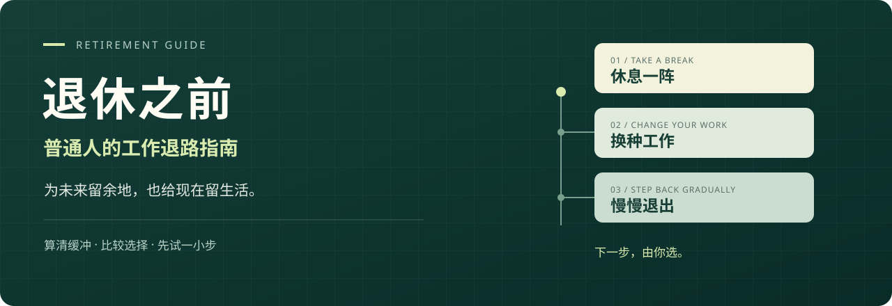

# 退休之前｜普通人的工作退路指南



**想休息一阵、换一份轻松的工作，还是慢慢退出全职？先把下一步算清楚。**

这里有停工缓冲计算器、六种生活场景、可复算案例和一套中文手册。面向中国大陆普通劳动者，帮助你把“我不想再这样上班了”变成可以比较、试验和调整的选择。

**[在线计算与阅读](https://retirement-before.supershen666.chatgpt.site) · [三分钟上手](docs/QUICKSTART.md) · [按自己的处境选入口](#先选一个你正在想的问题)**

<!-- LIVE_SITE_LINK -->

v0.3.0 · 内容更新：2026-10-21 · 政策与研究来源核查：2026-10-12（本次内容改版不代表政策已全部重查）

## 先选一个你正在想的问题

| 你的问题 | 从这里开始 | 先得到什么 |
|---|---|---|
| **我想休息三个月，要准备什么？** | [休息一阵](docs/scenarios/rest.md) | 一份包含支出、保障与重返工作的准备清单 |
| **只有 5 万、10 万、30 万，能做哪些准备？** | [从现有积蓄开始](docs/scenarios/savings.md) | 分清应急缓冲、短期试验和长期本金 |
| **降薪换轻松一点的工作，差多少？** | [换一种工作](docs/scenarios/lighter-work.md) | 比较收入缺口、真实工时和可退回的选择 |
| **半退休的兼职收入断了怎么办？** | [半退休与兼职](docs/scenarios/part-time.md) | 同时看有收入、少收入、零收入三个版本 |
| **搬去生活成本低的城市，真的省钱吗？** | [换个地方生活](docs/scenarios/move-city.md) | 把搬家、探亲、医疗和支持网络一起算进去 |
| **有房贷、孩子或父母需要照顾，先补哪块？** | [带着家庭责任做计划](docs/scenarios/family.md) | 一份共同责任账本和家庭讨论起点 |

不必先选定退休年龄。从最贴近你的一个问题开始，得到下一步就够了。

## 不用攒够几百万，今天也能算一笔

假设有 **10 万元可动用现金**，其中 **2 万元留给已知大额支出**；每月生活费 **5,000 元**，另需 **1,000 元保障缴费**，暂时没有收入：

```text
可用于日常生活的现金 = 100,000 − 20,000 = 80,000 元
每月现金消耗       = 5,000 + 1,000 = 6,000 元
静态现金缓冲       = 80,000 ÷ 6,000 ≈ 13.3 个月
```

“休息三个月”和“离职后找工作六个月”会消耗不同的缓冲。把它们放在一起比较，比追求一个精确退休年龄更适合作为起点。

这个算式只看固定收支下的短期现金：没有计算通胀、投资回报或意外支出，也没有证明长期退休可行。预留的 2 万元不能再拿来覆盖日常支出。**13.3 个月是模型里的耗尽时间，准备何时调整、何时重返工作，需要另留余量。**

网页交付包解压后，双击 `index.html` 即可使用停工缓冲计算器，无需安装 Python。使用仓库源码的构建步骤见 [快速入门](docs/QUICKSTART.md#从源码打开网页开发者)。

## 你会在这里得到什么

- **把退路分开。** 请假休息、换工作、半退休、长期退出全职，分别需要不同的准备。
- **把数字摆出来。** 算可支取现金、每月缺口、有限期限的兼职收入，以及养老金到账前的桥接期。
- **把坏消息加进去。** 收入中断、一次大额支出、照护责任变化，也需要一个能执行的方案。
- **把生活放回计划。** 工作以外的身份、关系和愿望，可以在退休之前开始。

“离开全职工作”“经济上不依赖工资”“按政策领取养老金”是三件事，可能相隔很多年。本项目把它们分别讨论。

## 想深入，再读这十二章

| 章节 | 解决的问题 |
|---|---|
| [01 为什么准备退休](docs/01-purpose.md) | 除了攒钱，你究竟想获得怎样的生活 |
| [02 选择你的路径](docs/02-paths.md) | 正常退休、半退休、阶段休息、提前退休怎么比较 |
| [03 先做一份真实账本](docs/03-budget.md) | 哪些钱能花，哪些资产不能重复计算 |
| [04 退休现金流怎么计算](docs/04-cashflow.md) | 桥接期、通胀、提取率、收益顺序与计算边界 |
| [05 中国大陆政策导航](docs/05-policy.md) | 延迟退休、养老金、医保、个人养老金分别查什么 |
| [06 让计划承受坏消息](docs/06-risk.md) | 收入中断、市场下跌、照护与流动性如何进入计划 |
| [07 家庭、住房与照护](docs/07-family.md) | 自住房、子女、父母和伴侣的需求如何一起考虑 |
| [08 工作与再就业](docs/08-work.md) | 不再全职以后，收入与职业退路怎样保留 |
| [09 生活、健康与身份](docs/09-life.md) | 没有绩效和头衔以后，一周怎么过 |
| [10 30天行动与年度复盘](docs/10-action.md) | 如何开始，何时调整，怎样避免把规划变成新考核 |
| [11 虚构案例与测算](docs/11-cases.md) | 不同起点为什么会得出不同选择 |
| [12 常见误区](docs/12-faq.md) | 4%法则、房产、存款、养老金有哪些常见误读 |

想先看一个具体问题？读 [多上一年班换来什么、每月少花 1,000 元、兼职十年和迁居的算术](docs/DECISIONS.md)。完整长文也可用仓库里的 `阅读版.html` 离线阅读。

## 六份模板，把阅读变成一个动作

| 现在要做的事 | 打开模板 |
|---|---|
| 列清能用的钱、支出和责任 | [财务盘点](templates/financial-inventory.md) |
| 把两个候选方案放到同一张表 | [个人计划](templates/personal-plan.md) |
| 查清养老、医保和办理信息 | [政策核查](templates/policy-check.md) |
| 与家人谈预算、责任和分歧 | [家庭会议](templates/family-meeting.md) |
| 试着安排不上班的一周 | [一周生活设计](templates/week-design.md) |
| 检查坏消息来了怎么办 | [压力复盘](templates/stress-review.md) |

## 需要长期测算？再用 Python 工具

短期现金缓冲只是第一步。需要比较跨年龄的收入、养老金起点、额外支出和确定性压力情景时，可以使用命令行工具。Python 3.10+，无第三方依赖。

在仓库目录执行，PowerShell、macOS 和 Linux 命令相同：

```bash
python tools/retirement.py examples/bridge.json
python tools/retirement.py examples/bridge.json --stress
python tools/retirement.py examples/part-time.json --stress
```

示例均为虚构。金额统一为人民币元，使用起始时点购买力，收益率输入税费后的实际收益率。先看首次未覆盖支出，再看期末资产；后期有钱不能消除早期缺口。字段、模型时点、CSV 和 JSON 输出见 [工具说明](tools/README.md)。

## 数字有出处，选择留给你

政策与研究的来源、适用范围和核查限制见 [来源登记](docs/SOURCES.md)。预算分类、生活实验和复盘属于本项目提供的方法；案例中的收入、收益率、养老金与寿命终点属于假设。

本项目提供教育性信息，不代替个人投资、税务或医疗方案。计算器输出不是收益承诺、社保资格认定或辞职结论；办理事项仍需核实当地最新规则。

项目起于一次关于“等退休”的视频分享。原始分享信息、无法取得正文或字幕的访问记录见 [视频访问记录](docs/SOURCES.md#视频访问记录)；本项目不冒充该视频的摘要或作者观点转述。

## 一起补上普通人的真实问题

欢迎通过 [Issue](https://github.com/superShen0916/retirement-guide/issues) 提问题，或按 [贡献指南](CONTRIBUTING.md) 提交修改。暂时没有答案的问题也值得记录，不需要一次写完一整章。

现在尤其需要三类补充：

1. **账本里容易漏掉什么？** 用虚构数字给一个能复算的漏项例子，并说明它会怎样改变选择。
2. **离职后如何衔接当地保障？** 请附地区、适用人群、官方文件与实施日期，区分文件规定和个人办理经历。
3. **试过以后，哪里和想象不同？** 休息、降薪换岗、兼职或迁居都可以；失败、回退和重新上班的经验同样有用。

个人经历请先获授权并去标识化，勿提交真实账单、身份号码或公司内部资料。维护和发布方法见 [发布说明](RELEASE.md)。原创内容与代码采用 [MIT 许可证](LICENSE)，外部内容保留各自权利。

**为未来留余地，也给现在留生活。**
